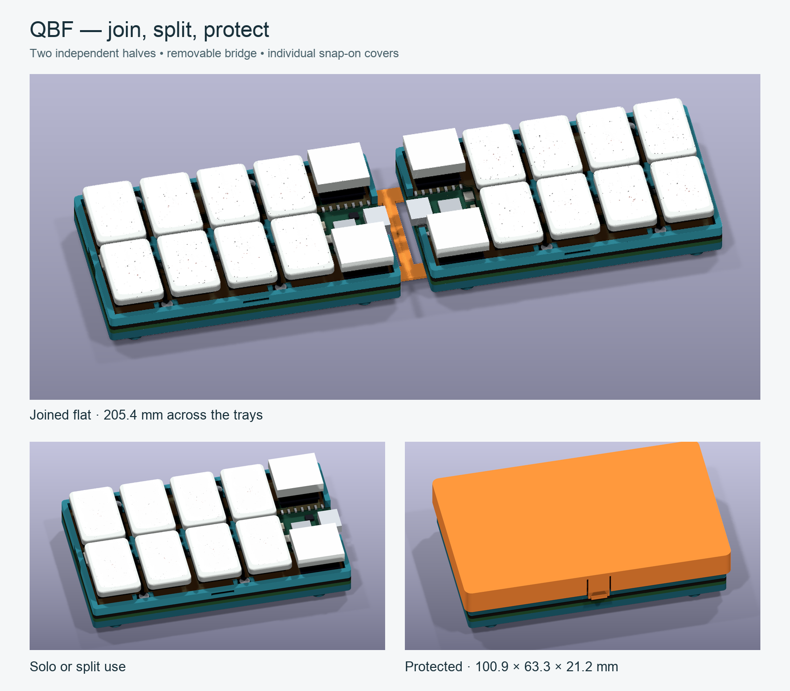

# QBF — compact chorded keyboard

QBF uses two identical ten-key wireless boards that can be used separately, joined flat or used one at a time. Eight portrait 1.5U keys form a close 4 × 2 grid; two 1U keys sit above and below a recessed Seeed XIAO nRF52840 Plus in column five. Key geometry is symmetric about the horizontal midpoint so the second half can rotate 180°. There is no display or external reset button.

Each main PCB and circuit-free baseplate measures **97.7 × 58.5 mm**. The accepted key layout is wider than the original 80 mm target. Four M2 mounts and a 2.25 mm border support the printed case. A protected 301055 battery sits between the main switch rows on the intact baseplate, with a side-entry JST-SH connector and a left-facing power switch tucked inside the PCB edge.

The new case has two independent trays and rims, individual snap-on covers, and one removable underside bridge. It joins the halves with controllers facing inward. Joining, separating and uncovering require no tools; initial board installation uses screws. There is no hinge. Each covered half measures **100.9 × 63.3 × 21.2 mm**. Separate the halves for ordinary straight USB cable access.

## Build files

- [Electronics guide](ergogen-kikad/README.md), [assembly requirements](ergogen-kikad/design/ASSEMBLY.md), [Ergogen source](ergogen-kikad/design/config.yaml).
- KiCad: [main PCB](ergogen-kikad/generated/pcbs/macropad.kicad_pcb), [baseplate](ergogen-kikad/generated/pcbs/baseplate.kicad_pcb), [routing preview](ergogen-kikad/generated/routing.png).
- Case: [print bundle](modular-case/generated/qbf-print-files.zip), [assembly and printing guide](modular-case/README.md), [FreeCAD](modular-case/generated/qbf_modular_case.FCStd), [dimensioned drawing](modular-case/generated/dimensions.png).
- Firmware: [standalone XIAO UF2](ergogen-kikad/generated/firmware/qbf_macropad.uf2), [shield and keymap](ergogen-kikad/config/boards/shields/qbf_macropad/), [build validation](ergogen-kikad/generated/firmware/validation.json).

Each key is wired directly to GPIO and GND, with no diode matrix. The supplied firmware makes each half an independent USB/Bluetooth keyboard and preserves the numerical test map `1 2 3 4 9 / 5 6 7 8 0`. Configure the desired chord behaviour before treating it as a Braille input device; the test map is not a completed Braille translator.

The work was completed sequentially: Ergogen layout, routed KiCad boards and assembly clearances, firmware, then case. Both boards report zero DRC violations and zero unconnected items. The electronics and case have nominal geometric checks; native KiCad renders retain all components in cap-free inspection except the ten caps. The recessed XIAO soldering process, purchased hardware, clip durability and cover strength still require a physical prototype.

## Regeneration

Follow the electronics guide to regenerate and verify the boards, then build firmware with `./scripts/build-firmware.sh /path/to/zmk-repository`. After those stages are reviewed, run `./scripts/generate-mechanical.sh`, `./modular-case/render.sh` and `./modular-case/present.sh` sequentially. Read the [case guide](modular-case/README.md) for dependencies and print orientations.

The earlier `bumper-case/` and `mechanical/` files, and AI concept images in `assets/renders/`, are historical. They do not describe or fit the current board.

## Mikoto controller diagnostics

The separate [automated test fixture](diagnostics/mikoto/README.md) uses a SuperMini nRF52840 to reset a Mikoto, enter UF2 mode and simulate four direct keyboard inputs. It includes a wiring guide, fixture code, test firmware and a macOS USB checker. Its physical fixture remains to be assembled and tested.
