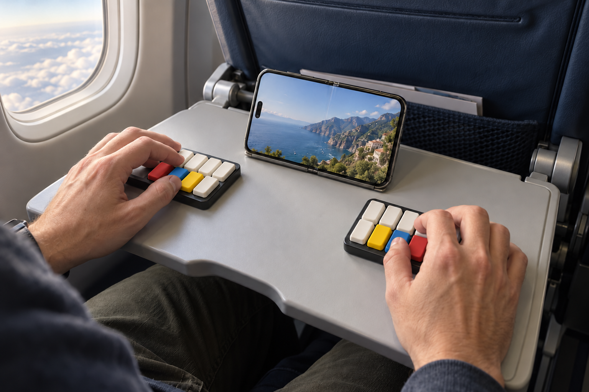
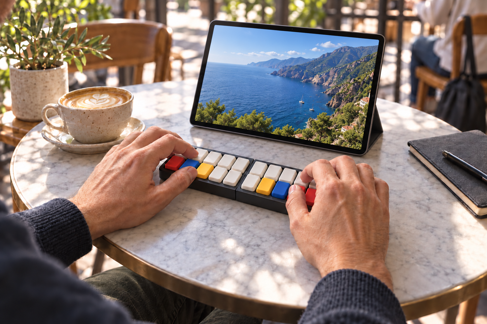
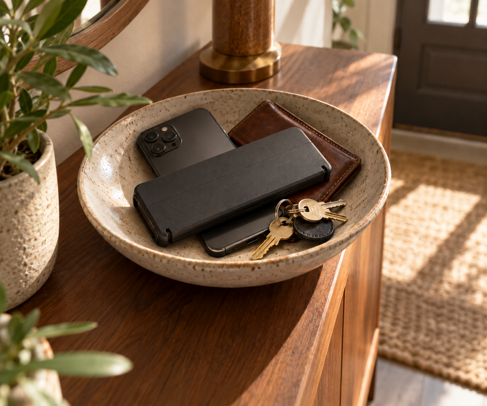

# QBF — pocketable Perkins-style keyboard

QBF is a small split keyboard for chorded input. On a Perkins keyboard, you press several keys **together** to enter the dots of a Braille cell, then release them as one chord. A six-dot cell has 64 possible patterns; eight-dot Braille adds two more dot positions. QBF explores that input method with two identical, portable ten-key low-profile boards that can be spaced apart, joined in a printed case, or used one at a time.

Each half uses ten Kailh Choc v1 switches: eight portrait 1.5U keys and two landscape 1.5U thumb keys beside a socketed nice!nano v2 and nice!view display. The PCB and circuit-free baseplate measure 117.25 × 58 mm. Six M2 screws secure a [three-part bumper case](bumper-case/README.md), which rises from the PCB top and includes an upward guard and continuous battery roof. The original protected 301055 220 mAh battery sits in a main-PCB-only opening on the intact baseplate.

The proposed keycap set has no legends: all four top keys and the inner bottom key on each half are white. The other three bottom keys are red, blue, and yellow, mirrored across the two halves.

## Ways to use it

These AI-generated renders illustrate the earlier eight-key layout and intended setups. They are concept images; use the PCB and CAD files for dimensions and clearances.

### Split around an iPhone Duo

The small halves leave room for an opened [iPhone Duo](https://www.apple.com/iphone-duo/) between them on an airplane tray table.

### Joined at a café

The exposed case joins both halves in front of a large [13-inch iPad Pro](https://www.apple.com/ipad-pro/) on a small café table.

### Two-handed on a neck strap

The side mounting holes make a chest-height, single-half setup possible. Turning the board 90° places its landscape 1.5U caps in two columns with a gap between them for two-handed chording. Check the strap fittings and cap clearance on a physical build.

### Packed in the entryway

Flip the assemblies before sliding them into the case so the keys face its solid floor. The protected package can sit with other pocket items.

## Brief build guide

1. **Order the boards.** Fabricate two copies each of the [main PCB](ergogen-kikad/generated/pcbs/macropad.kicad_pcb) and [base plate](ergogen-kikad/generated/pcbs/baseplate.kicad_pcb), nominally 1.6 mm FR4. The design files and regeneration instructions are in the [electronics guide](ergogen-kikad/README.md).
2. **Fit the switches.** Each half needs ten Choc v1 switches, eight portrait 1.5U caps and two landscape 1.5U caps. For removable switches, solder 20 Mill-Max 7305 receptacles into that half's 1.6 mm switch holes; otherwise solder the switches directly. Try the exact switch pins in a sample socket first.
3. **Fit the controller and display.** Use the socketed nice!nano v2 and ready-made nice!view module described in the [electronics guide](ergogen-kikad/README.md). The display uses its native five-pin through-hole socket; fit it before lowering the orange case over the assembled board.
4. **Add the underside.** The bumper case needs the solid baseplate beneath its recessed battery. Align all lead-clearance and M2 holes and follow the case guide for hardware. A 46/56 mm adhesive MagSafe-compatible ring can be aligned to the four underside ticks; check its overlap with holes and solder joints first.
5. **Flash and configure.** The [ZMK shield and keymap](ergogen-kikad/config/boards/shields/qbf_macropad/) build for `nice_nano@2.0.0//zmk` with the `nice_view` shield. The sample sends 1–8 on the original keys and 9/0 on the fifth column to prove the wiring; configure your desired chords and left/right roles.
6. **Print the case.** Follow the [three-part bumper guide](bumper-case/README.md) for the original battery, main-board-only well, thin/standard M2 nut stack, cap-height guard and print orientations. The earlier carrier remains a separate option: Print two lower rails, two upper rails, and one case from the [mechanical files](mechanical/README.md). Attach each rail pair under a board with thin double-sided tape and its locating pegs. Insert one half rotated 180° so both USB-C ports face outward. Slide in keycaps up for typing, or keycaps down for transport. Remove the rails if using the M2 holes for a neck strap.

The electronics pass KiCad's board checks, and the printed parts are valid FreeCAD solids. The assembled keyboard, fit, and protected-mode clearance still need a physical prototype.

## Mikoto controller diagnostics

The [automated test fixture](diagnostics/mikoto/README.md) uses a SuperMini nRF52840 to reset a Mikoto, enter UF2 mode and simulate four direct keyboard inputs. The controllers connect through five 1 kΩ series resistors and shared ground, using open-drain signals. It includes an [HTML/SVG wiring guide](diagnostics/mikoto/wiring/index.html), SuperMini fixture code, compiled Mikoto test firmware and a macOS checker for USB keyboard press/release events. The software is validated; the physical fixture still needs to be assembled and tested.
