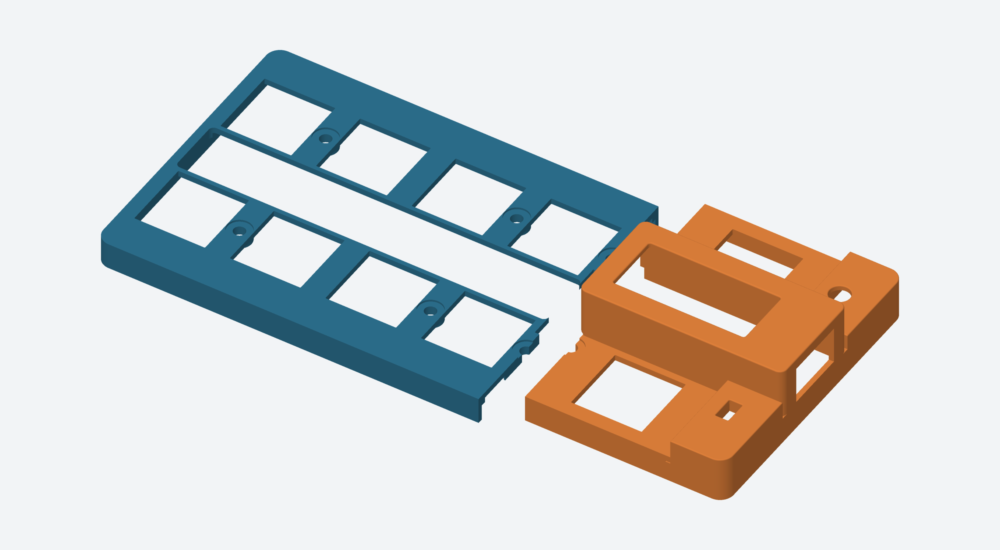

# Two-part QBF bumper case

Two printed parts for one QBF main PCB and its blank baseplate. The left part holds t1–t4/b1–b4. The right part holds t5/b5 and covers the nice!nano and nice!view. The current KiCad assembly supplies dimensions and clearance references; **the FreeCAD and STEP deliverables contain only the two case parts**. The original electronics and the earlier `mechanical/` carrier are unchanged.




## Files

| File | Purpose |
| --- | --- |
| [QBF_Bumper_Case.FCStd](QBF_Bumper_Case.FCStd) | Native FreeCAD solids in their installed positions, plus dimension properties |
| [generated/bumper_case.step](generated/bumper_case.step) | Both case solids in their installed positions |
| [generated/left_bumper.step](generated/left_bumper.step), [generated/right_bumper.step](generated/right_bumper.step) | Separate editable STEP solids |
| [generated/left_bumper_print.stl](generated/left_bumper_print.stl), [generated/right_bumper_print.stl](generated/right_bumper_print.stl) | **Print one of each**; highest face already rotated onto z=0 |
| `generated/*_assembly.stl` | Same solids in installed coordinates; not the supplied print orientation |
| [parameters.json](parameters.json), [build.py](build.py) | Dimension source and repeatable native-solid construction; edit parameters and rebuild to change the design |
| [generated/verification.json](generated/verification.json), [generated/assembly-verification.json](generated/assembly-verification.json) | Solid, mesh, component, travel, hardware and stack checks |

The FreeCAD file stores the resulting solids, rather than a sketch-constrained feature history. Its displayed dimension properties record the build settings; changing those properties alone does not regenerate the solids. Use `parameters.json` and the builder for dimension changes. No PCB, cap or electronic component model is embedded in that document.

## Geometry and fastening

The nominal 114.25 × 55 mm board has a 0.2 mm clearance to the inside of the 1 mm outside skirt. The assembled plan envelope is approximately **116.65 × 57.4 mm**. Rounded corners follow the board outline. The two pieces have a 0.25 mm seam centered at x=75.425 mm, between columns four and five. The right cover slightly overhangs the seam above the left plate without touching it.

Each FR4 layer is 1.6 mm thick, with **zero gap** between the main PCB and baseplate. Relative to the main PCB top at z=0, the main board occupies −1.6 to 0 mm and the baseplate −3.2 to −1.6 mm. The outside skirt stops at **z=−3.2 mm**, flush with the baseplate underside. The inside ledges rest on the main PCB top. The battery opening relieves the ledge locally near the left edge.

Six **M2 × 7 mm screws**, measured under the head, enter from below the baseplate and pass through both boards and the printed clearance holes. Use six plain **4 mm across-flats, 1.6 mm thick M2 hex nuts**, seated at z=1.8 mm. No washer or printed thread is specified. The modeled screw head is 3.8 mm diameter × 1.2 mm high; the 2 mm feet extend 0.8 mm below it. Verify the actual purchased heads and nut dimensions. An 8 mm screw needs its protrusion checked or trimmed; do not substitute it blindly.

Four support rims are wholly in the left part. The two rims between columns four and five are divided across the seam: each nut spans both semicircular supports, so these two screws secure both parts. Rounded fins extend above and below each rim into the gaps between switch bodies. The printed screw bores are 2.3 mm; the PCB holes remain their existing 2.2 mm diameter. The nut recesses are round, so hold each nut while tightening. Tighten lightly and evenly, with the boards supported; PETG is not a torque stop.

The four adhesive rubber feet are **10 × 20 × 2 mm**, with the 20 mm direction running front-to-back. Suggested lower-left corners in the case coordinate system are (2,2), (102.25,2), (2,33) and (102.25,33) mm. This leaves the screw heads clear. Feet are assembly references only and are not part of either print.

## Switch plate, thumb access and cover

The Choc v1 plate is **1.2 mm thick**, from z=1.0 to z=2.2 mm. The switch apertures are 14.1 mm with 0.15 mm corner radii, giving a small printing allowance around a nominal 14 mm opening. The left part has no plastic higher than z=2.2 mm. The nut tops are at z=3.4 mm, 0.6 mm below the conservative fully depressed cap undersides. The plate datum and **3 mm full travel** follow the [Kailh PG1350 drawing and specification](https://cdn-shop.adafruit.com/product-files/5114/5114_CPG135001D03.pdf).

The low strip beside t5/b5 remains at the **2.2 mm switch-plate height** before the control hoods rise. The hoods start at x=104.5 mm, leaving 1.3 mm lateral clearance from the thumb-cap edges; the outer skirt continues to the baseplate underside. The controller cover has a flat top at z=12.4 mm, 1 mm walls and roof, and a rounded **26.3 × 11.8 mm display window**. It is open at the left underneath the roof to clear the native nice!view socket and the fourth-column caps. The controller is covered from above and on the other three sides. The outer side has a **12 × 7.5 mm USB opening**; separate low hoods cover the PCB and housings around the power switch and reset button beside the thumb keys. No flying display wires are required.

The reset hood has a **4 mm circular hole** centered over the modeled 3.3 mm button. Its underside is at z=4.3 mm, leaving **0.2 mm clearance above the four raised housing posts**. The 1 mm roof ends at z=5.3 mm, recessing the button by **1 mm**. The power hood underside is at z=4.9 mm, **0.2 mm above its 4.7 mm housing**. Its roof ends at z=5.9 mm, leaving **2.8 mm of actuator exposed**. The **2.6 × 4.6 mm slot** accommodates the 2 mm actuator width and full 2 mm slide stroke with 0.3 mm side/end clearance. The stroke and housing height match the [C&K OS series specification](https://www.ckswitches.com/media/1428/os.pdf); the actuator profile and reset housing posts come from the installed KiCad STEP models. Native actuator geometry is checked at both positions and intermediate points.

The battery, wires, mating plug and side-entry JST-PH header occupy an open corridor between the original rows. The case does not contact the battery. The roof clears the modeled display top by about 0.49 mm. The modeled controller is only **0.20 mm** from the cover wall, and each thumb cap has **0.15 mm** lateral clearance to the cover over its full travel. Those tight dimensions follow the available space in the existing assembly and should be checked carefully on the first print.

## Printing and assembly


Print PETG as a starting material. The supplied print STLs already put the left plate face and the right cover face against the bed, as requested. The left nut-seat recesses make short local bridges. **The right part needs removable supports under its lower switch-plate wings, mounting areas, perimeter ledges and control-hood roofs.** Keep support scars out of the switch openings, nut seats and PCB contact surfaces. A slicer preview and a first-fit print are necessary before a final material comparison.

The specified **2 mm nozzle** cannot conventionally resolve the requested 1 mm walls and 1.2 mm switch plate. Use an appropriately smaller nozzle, or have the print provider propose a changed geometry. The case retains the requested dimensions; no assumption that “2 mm” meant “0.2 mm” has been made. A 0.2 or 0.4 mm nozzle is a practical starting point for preserving these features. Check elephant-foot compensation around the plate openings and mating seam.

1. Remove caps and the socketed display. If the switches are already soldered, this full switch plate generally requires desoldering/removing them to install it; it cannot slide around installed switch flanges.
2. Fit the controller and display into their native sockets before lowering the right case over them. The display window is smaller than the whole module, so the module cannot be inserted through it after the case is installed. Fit switches into the appropriate plate part, confirm clip engagement, then carefully align the case and switch pins with the populated main PCB. Solder or socket the switches as applicable to the board build; no display wires are added.
3. Stack the baseplate directly below the main PCB. Verify that every protruding solder joint and component lead enters its existing relief hole, so the two board faces meet without rocking.
4. Insert the six screws from underneath, place the nuts from above with caps removed, and tighten evenly. The outer two nuts clamp both case halves. Check the printed contact rims sit flat on the PCB.
5. Refit caps, exercise all keys to full travel, plug in USB and test both controls. Attach the four feet after checking the screw heads and solder protrusions remain above the feet's bottom plane.

## Verification and previews

Both case parts are valid single FreeCAD solids, and both print meshes are closed. Automated checks cover the conservative full cap travel envelopes, actual cap mesh bounds, switch bodies, battery and connector corridor, controller, display and socket, native KiCad STEP control bodies and power-actuator travel, both PCB solids, screw passages, nut seating area, screw heads and feet. The shared nut supports retain more than 9 mm² contact area per nut. The case pieces have no volume overlap.

The existing simplified Choc 3D model puts its flange at a height that intersects a drawing-based plate. That rendering approximation is excluded from flange interference testing; the actual drawing's body size and plate datum govern switch mating. Other component approximations are documented in [the existing model notes](../ergogen-kikad/design/models/README.md). The cap model is a rendering mesh, not a guarantee of its internal cavity. Physical clip retention, bottomed-out cap fit, connector boot fit, solder clearance, printing tolerances and durability remain untested.

- [Assembly with keycaps](generated/assembled.png): native KiCad render with the complete keyboard assembly and case.
- [Assembly without keycaps](generated/inspection.png): only the ten keycap models are hidden. All ten Choc switches, the display, socket, controller, battery, connectors, controls, boards, fasteners and feet remain present.
- [Exploded view](generated/exploded.png): the case raised above the board for inspection; illustrative, not an assembly sequence.
- [Case solids](generated/case_only.png) and [underside](generated/underside.png): direct rasterizations of the exported case meshes, with the right part separated for visibility.

Assembly references are temporary and are not saved into the case CAD. Existing cap render terms remain in [the source model README](../ergogen-kikad/design/models/source/MBK_README.md).

## Recurring assembly previews

From the repository root, run `./bumper-case/render.sh` to refresh both assembly previews. `prepare_views.py` and `render.sh` are committed regeneration scripts. The visibility inventory and checks are written to [generated/preview-components.json](generated/preview-components.json); the two assembly views must differ only by the ten keycap models. Inspect both PNGs after generating them. Future case work is governed by [AGENTS.md](AGENTS.md), also referenced from the repository instructions.

## Rebuild

From the repository root:

```sh
./bumper-case/build.sh
./bumper-case/render.sh
python3 bumper-case/render_parts.py
```

`build.sh` uses the installed FreeCAD Python and the captured placement metadata; it is self-contained and does not need to load the keyboard models. Override `FREECAD_PYTHON` and `FREECAD_LIB` when needed. Alternatively, run `QBF_Bumper_Case.FCMacro` inside FreeCAD to rebuild and open a colored view of the case solids. `render.sh` needs KiCad and the current electronics/model source files to verify and render the assembly, and checks their hashes against the captured reference. It writes only inside this folder and a temporary directory. `render_parts.py` requires NumPy and Pillow and renders the STL geometry directly; a Python environment with those libraries is sufficient.

If the upstream PCB or component models change, first run `capture_reference.py` with KiCad's Python, review the new positions and dimensions, then rebuild and rerun the checks. The captured origin is the current board's lower-left corner, (152.875,176) in KiCad coordinates. Case coordinates use millimetres, x right, y up and z toward the keys. Board outline changes also require updating the case parameters and perimeter construction, not merely recapturing metadata.
