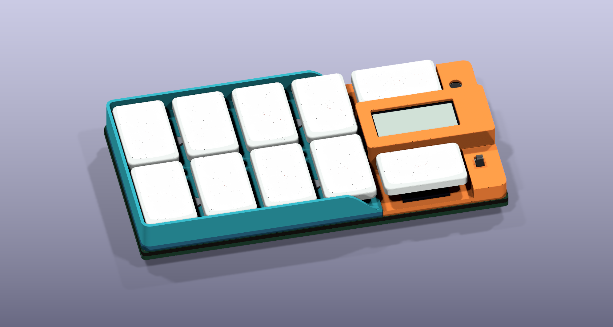
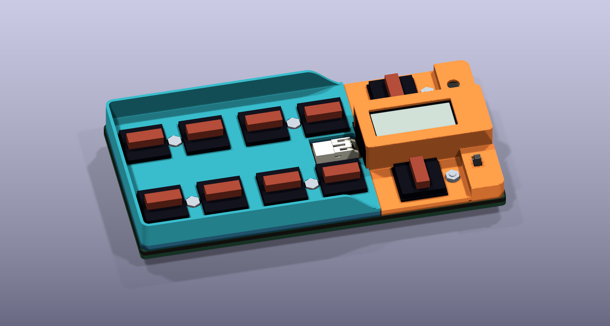
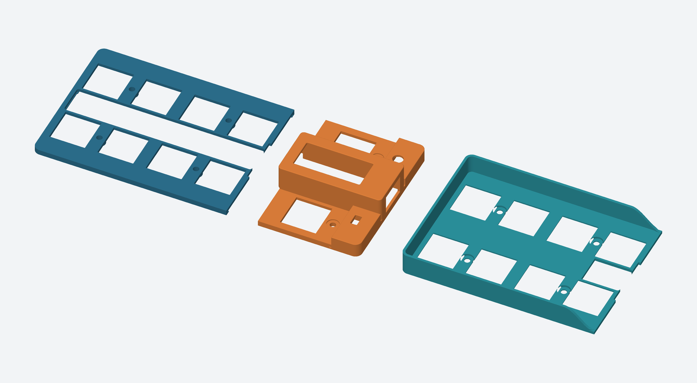

# Three-part QBF bumper case

The case contains a lower blue switch plate, an orange controller/control cover, and a new upward-facing blue guard. The guard's flat print face touches the lower blue plate, its walls reach the resting keycap tops, and its continuous 1 mm roof covers the original protected 301055 battery. All three parts are secured in the PCB/screw/nut stack.

The opening is **only in the main PCB**. The baseplate remains continuous underneath the battery and supports it. The case CAD contains only the three printed solids; keyboard components appear in separate assembly previews.





## Deliverables

| File | Purpose |
| --- | --- |
| [QBF_Bumper_Case.FCStd](QBF_Bumper_Case.FCStd) | Three native FreeCAD solids in installed positions, plus dimension records |
| [generated/bumper_case.step](generated/bumper_case.step) | All three case parts, in installed positions |
| [generated/left_bumper.step](generated/left_bumper.step), [generated/right_bumper.step](generated/right_bumper.step), [generated/upper_guard.step](generated/upper_guard.step) | Individual STEP solids |
| [generated/left_bumper_print.stl](generated/left_bumper_print.stl) | Print one lower blue part, PCB-contact face down, upright |
| [generated/right_bumper_print.stl](generated/right_bumper_print.stl) | Print one orange part, PCB-contact face down, upright |
| [generated/upper_guard_print.stl](generated/upper_guard_print.stl) | Print one upper guard, flat mating face down |
| `generated/*_assembly.stl` | Meshes in installed coordinates rather than print orientation |
| [parameters.json](parameters.json), [build.py](build.py), [upper_guard.py](upper_guard.py) | Editable dimensions and repeatable native-solid construction |
| [generated/verification.json](generated/verification.json), [generated/assembly-verification.json](generated/assembly-verification.json) | Solid, mesh, component, shoulder, key travel and hardware checks |

The FreeCAD file stores resulting solids rather than a sketch-constrained feature history. Edit the source parameters and rebuild; changing its dimension-record properties alone does not regenerate geometry. Run [QBF_Bumper_Case.FCMacro](QBF_Bumper_Case.FCMacro) inside FreeCAD to rebuild and open a colored view.

## Boards and original battery

Both boards are **117.25 × 58 mm**, with a new 1.5 mm border around every side of the unchanged component layout. Each remains 1.6 mm thick and their faces touch directly. With the main PCB top at z=0, the main PCB occupies −1.6 to 0 mm and the baseplate −3.2 to −1.6 mm. The lower blue and orange parts now start at **z=0**, on the PCB top. There is no skirt around either board and no printed case material below the main PCB top. Their outer footprints sit 0.3 mm inside the enlarged PCB edge.

Case XY dimensions below use the fixed switch-layout datum, preserving all existing component coordinates. The physical PCB bounds in that frame are **(−1.5,−1.5) to (115.75,56.5)**. Add (1.5,1.5) to convert any case XY location to a measurement from the current PCB lower-left corner. `board_geometry.json` records both the PCB and assembly origins; the capture and preview scripts keep them distinct.

The main board has a **58.1 × 11.1 mm opening**, centered at (30.4,27.5), with 0.5 mm corner chamfers. Its lower-left corner is (1.35,21.95), leaving a 2.85 mm PCB web along the enlarged left edge. In current PCB coordinates the opening center is (31.9,29) and lower-left corner is (2.85,23.45). The baseplate has **no matching battery opening** and retains its existing 87 lead/mount clearance holes. Native STEP verification checks that the entire floor beneath the opening is present, not just its center.

The original **57.5 × 10.5 × 3.5 mm protected 301055, nominally 220 mAh**, is retained. It moves 0.75 mm right to center (30.4,27.5). Its lower-left corner is (1.65,22.25), giving 0.3 mm side clearance to the well. A 0.2 mm insulating adhesive layer on the baseplate puts the pack bottom at **−1.4 mm** and top at **2.1 mm**. Insulate and smooth the FR4 cut edges with thin polyimide tape; do not force the pouch against them or use the roof to compress it. Measure the supplied pack, including its protection board and wrap, before assembly.

The upper guard's roof underside is **2.4 mm**, leaving 0.3 mm above the battery. Its 1 mm roof ends at **3.4 mm**, leaving **0.6 mm below the conservative fully depressed keycap undersides** at z=4.0. The entire protected battery footprint is covered; the connector remains outside the roof. A full connector cover is not feasible with the present stack: the JST housing reaches z=4.85, while the fourth-column caps descend to z=4.0 over its edges. Only a 1 mm gap remains between those caps, too narrow to cover the 5.9 mm housing. The connector is therefore left accessible. The existing side-entry JST-PH stays near the controller, with 1 mm between the pack end and the modeled mating plug. Route its insulated leads without pinching them against the opening or roof. See [battery decision and sourcing notes](battery-selection.md).

## Screws, nuts and feet

Four mounting centers stay between columns 1/2 and 3/4: x=18.275/56.375, y=13.75/41.25 mm. The outer pair now sits **between column five and the controls**, at **(100.5,8.75)** and **(100.5,46.25)** in the fixed case frame, or **(102,10.25)** and **(102,47.75)** from the enlarged PCB corner. Each nut has **2 mm clearance to the orange upright wall**. The nut-to-reset gap is 3.225 mm, nut-to-power gap 4.075 mm, and nut-to-Choc-shoulder gap 1.05 mm. Both supports lie fully inside the orange part; no fastener is split across the seam between the two original case parts. The board border supports the on-top walls; the component layout is unchanged.

Use six **M2 × 7 mm screws**, measured under the head. They enter from below the baseplate and pass through both FR4 layers. There are no printed threads or washers.

| Mounts | Printed stack above main PCB | Nuts |
| --- | --- | --- |
| Four left mounts | Lower blue support to z=2.2, upper guard's supported 0.4 mm flange to z=2.6 | Four **DIN 439 M2 thin nuts, 4 mm AF × 1.2 mm thick**; tops at z=3.8 |
| Two relocated right mounts | Orange support rim, nut seat at z=1.8 | Two standard **4 mm AF × 1.6 mm M2 nuts**; tops at z=3.4 |

The left nuts clamp the guard and lower blue part together against the boards. The right nuts clamp the orange part directly to the boards. Rounded fins strengthen the lower support rims. Printed clearance holes are 2.3 mm and PCB holes remain 2.2 mm. Hold the nuts with a suitable fine tool while tightening lightly and evenly; PETG is not a torque stop. Standard 1.6 mm nuts do not fit the four guard positions. The nominal screw tips finish at z=3.8, leaving 0.2 mm below the conservative pressed-cap underside at the four left and two right positions; 8 mm screws need shortening or a new travel check.

The four left nut faces have only **0.025 mm nominal lateral clearance to the adjacent 15 mm switch shoulders**. This is a critical physical fit check: measure actual shoulders/nuts and do not tighten a nut against a switch housing. Thin-nut bearing area is approximately 9.11 mm² at each guard flange after shoulder relief. The [DIN 439 dimensional table](https://www.aspenfasteners.com/content/pdf/Metric_DIN_439_spec.pdf) specifies the selected thin nut dimensions.

Use four adhesive **10 × 20 × 2 mm rubber feet**, with 20 mm front-to-back. Suggested lower-left corners are (2,2), (87.75,2), (2,33), and (87.75,33) mm. The right pair moved inward to clear the relocated screw heads. The modeled heads are 3.8 mm diameter × 1.2 mm high, leaving 0.8 mm to the feet's bottom plane; verify purchased hardware. Feet are references, not printed case parts.

## Guard, switch plate and controls

The lower Choc v1 plate stays **1.2 mm thick**, z=1.0 to 2.2, with 14.1 mm apertures. The upper guard's lowest face is z=2.2, resting flat against it. The guard's 1 mm walls follow the perimeter border on top of the enlarged PCB and rise to **z=10.9691 mm**, the modeled resting cap crown. There are no upright dividers between columns or between the portrait and landscape keys. The two perimeter ends curve down over 12 mm near the landscape thumb keys, ending at the low plate height of z=3.4 mm. Low plate webs, supported nut flanges and the battery roof remain below key travel. Relief near the controller/display clears the native socket. The keycap mesh is a rendering reference, so cap internal cavities still need checking on physical parts.

The upper guard has **15.3 mm switch-shoulder reliefs through z=3.1**, clearing the nominal 15 mm shoulders at z=2.2 to 3.0. The Choc reference model now uses that drawing-based shoulder height. Both the original 14.1 mm plate apertures and the larger upper shoulder reliefs are intentional. The [Kailh drawing](https://cdn-shop.adafruit.com/product-files/5114/5114_CPG135001D03.pdf) supplies the plate datum and 3 mm full travel. Minimum conservative cap clearance elsewhere is 0.15 mm, notably beside the controller cover.

The orange part retains the **26.3 × 11.8 mm display window**, roof at z=12.4, and **12 × 7.5 mm USB opening**. It remains open under the left side of that roof to clear the display socket and fourth-column caps. The thumb-facing strip stays low before the control hoods rise, leaving 1.3 mm between the hoods and thumb-cap edges.

The reset hood has a **4 mm circular opening**, a nominal 0.2 mm roof gap over its raised casing posts before the internal corner fillets, and a roof at z=5.3. The button is recessed **1 mm**. The power hood has 0.2 mm housing clearance and a roof at z=5.9, leaving **2.8 mm of actuator exposed**. Its **2.6 × 4.6 mm slot** clears the full 2 mm slide stroke. Native actuator geometry is checked at both ends and intermediate positions. Hardware is checked directly against both native control housings and the orange upright walls, with at least 1 mm required clearance. The [C&K specification](https://www.ckswitches.com/media/1428/os.pdf) provides the stroke and housing height.

## Printing and assembly



PETG remains the initial material. **All three parts print upright.** The lower blue and orange parts use their PCB-contact faces as the build faces; the upper guard uses its flat mating face. Print STLs are already placed at z=0 with these orientations. Internal fillets support the lower plate edges (0.5 mm radius), controller-cover ceiling edges (2 mm), and reset/power hood ceilings (0.4 mm). These preserve modeled component and travel clearance. The controller window frame and low plate still contain bridges/overhangs: inspect the slicer preview and add removable support where the chosen printer needs it. The geometry checks do not establish a support-free print.

The upper guard roof begins 0.2 mm above its mating/build face, forming an 11.7 mm bridge on the second 0.2 mm layer. Its top is coplanar with the surrounding low plate at z=3.4 mm. Preserve that shallow underside recess in the slicer; conventional supports may not fit. Check bridge droop and remove every support remnant near the battery and PCB contact surfaces. The four 0.4 mm compression flanges are supported by the lower blue part in use and need intact layers.

A true **2 mm nozzle** cannot conventionally resolve the requested 1 mm walls. Use a suitably smaller nozzle to preserve these dimensions; a 0.2 or 0.4 mm nozzle is a practical starting point. Check elephant-foot compensation around switch openings, the seam and mating faces. Geometry validation does not replace a first-fit print.

1. Remove keycaps. Installing the switch plates around an already soldered board generally requires removing/desoldering the switches; the plate cannot pass around their flanges.
2. Clean the main-board cutout, insulate its edges, and put the 0.2 mm insulating adhesive on the **solid baseplate floor**. Place the battery without pressure and arrange the insulated leads toward J1. Confirm board faces meet without rocking and all solder protrusions enter their existing relief holes.
3. Fit controller and display into their native sockets before lowering the orange part over them; the whole display cannot pass through its window afterward. Fit switches into the plates and carefully align pins with the main PCB. Socket or solder them as applicable. No flying display wires are added.
4. Seat the upper guard's flat face on the lower blue plate. Insert six screws from below. Install the four thin left nuts and two standard right nuts with caps removed. Check shoulder/nut fit, support contact and battery clearance before tightening lightly.
5. Fit keycaps and check every key through full travel. Test power, recessed reset and USB access. Fit the four feet after confirming screw heads and solder protrusions stay above their bottom plane.

## Recurring checks and previews

From the repository root:

```sh
./scripts/build-3d-models.sh
./scripts/generate.sh
./scripts/generate-mechanical.sh
./scripts/render-3d.sh
```

KiCad must be closed for board regeneration. The PCB script routes both boards, runs DRC, and runs **`./scripts/check-battery-well.sh`** before replacing outputs. The well check needs FreeCAD and uses native KiCad STEP solids to prove the main-board opening, the complete intact baseplate floor, and battery clearance. Its report is [../ergogen-kikad/generated/checks/battery-well.json](../ergogen-kikad/generated/checks/battery-well.json). The enlarged board outline and relocated mounts are regenerated from the source config; direct GPIO switch nets are unchanged; the MCU ground pad uses a solid zone connection and may need more soldering heat than a thermal pad.

After PCB/model changes, recapture placements with KiCad's Python, then rebuild:

```sh
/Applications/KiCad/KiCad.app/Contents/Frameworks/Python.framework/Versions/3.9/bin/python3.9 bumper-case/capture_reference.py
./bumper-case/build.sh
./bumper-case/render.sh
python3 bumper-case/render_parts.py
```

The last command needs NumPy and Pillow. `build.sh` uses installed FreeCAD Python; override `FREECAD_PYTHON`/`FREECAD_LIB` when needed. `render.sh` uses current keyboard source files only as temporary assembly references, verifies their captured hashes, and generates native KiCad images. It does not embed keyboard geometry in the case document or alter the original PCB assignments.

- [With keycaps](generated/assembled.png) and [without keycaps](generated/inspection.png): **only the ten keycaps differ**. Both retain the display, all ten switches, battery, controller, controls, connectors, boards, hardware and all three case parts. A covered component can be hidden from the camera while remaining in the assembly. [Visibility checks](generated/preview-components.json) enforce this.
- [Exploded assembly](generated/exploded.png): raised case components for inspection, not an assembly sequence.
- [Case parts](generated/case_only.png), [underside](generated/underside.png), [print orientation](generated/print_orientation.png): direct rasterizations of exported STL geometry.

Each printed part is checked as one valid solid with a closed mesh. Checks also cover nominal switch bodies and shoulders, complete conservative cap travel, battery roof, native control solids and actuator movement, hardware, both PCB layers and the feet. Actual soldering, printing tolerance, clip retention, cap cavities, battery procurement limits and mechanical durability remain untested. Keep the existing [model limitations and cap rendering terms](../ergogen-kikad/design/models/README.md).
